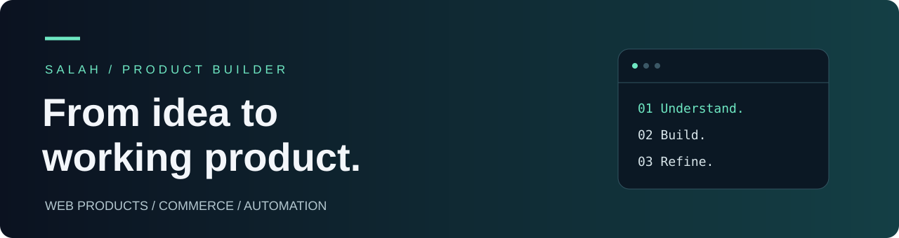

# Salah · صلاح
### Building useful products, from idea to implementation.
**Web applications · E-commerce · Workflow automation**

أحوّل الأفكار واحتياجات العمل إلى منتجات رقمية واضحة وعملية.

[Explore public repositories](https://github.com/isws-png?tab=repositories)

---

## What I work on

<table>
<tr>
<td width="50%" valign="top">

### 01 / Web products
Full-stack web applications that connect customer-facing experiences with the tools teams use behind the scenes.

**Focus:** interfaces, APIs, dashboards and shared application logic.

</td>
<td width="50%" valign="top">

### 02 / Commerce & operations
Digital storefronts and administrative tools built around everyday business workflows.

**Focus:** product experiences, staff workflows and operational visibility.

</td>
</tr>
<tr>
<td width="50%" valign="top">

### 03 / Integrations & automation
Connecting services and reducing repetitive work through API integrations and automated workflows.

**Focus:** messaging, webhooks and connected systems.

</td>
<td width="50%" valign="top">

### 04 / AI-assisted development
Using AI coding tools as part of an iterative development workflow, from planning and implementation to review.

**Focus:** clear requirements, structured iteration and maintainable outcomes.

</td>
</tr>
</table>

## Technologies in my projects

| Layer | Tools |
| :--- | :--- |
| Frontend | **TypeScript · JavaScript · Next.js** |
| Backend | **Node.js · NestJS · Fastify** |
| Data | **PostgreSQL · Prisma** |
| Workflow & quality | **Git · GitHub Actions · Docker · pnpm · Vitest** |

## How I approach building

**Understand the workflow → Define the scope → Build → Review → Refine**

I care about the connection between a business need, the user experience and the system that supports it.

### نبذة بالعربية
أعمل على تطوير تطبيقات الويب والمتاجر الإلكترونية ولوحات التحكم وأتمتة الإجراءات. أجمع بين فهم احتياج العمل وبناء الواجهات والخدمات الخلفية، وأستفيد من أدوات الذكاء الاصطناعي ضمن عملية تطوير ومراجعة مستمرة.

---

Much of my work lives in private repositories. This profile shares my areas of focus and technology stack; public forks retain attribution to their original authors.
